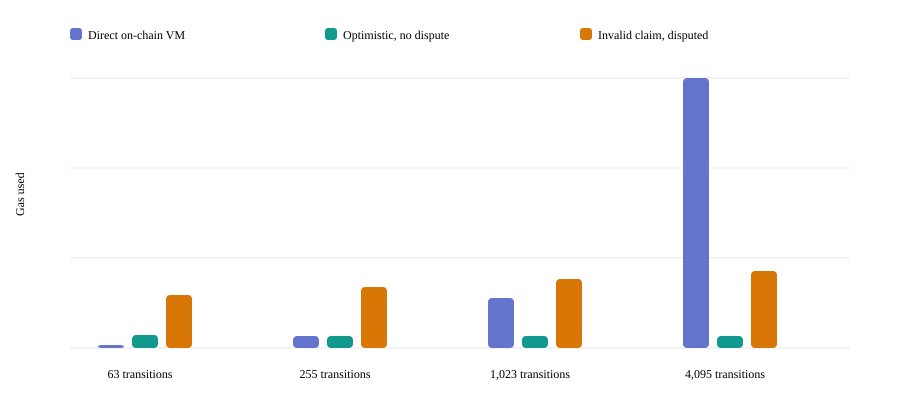
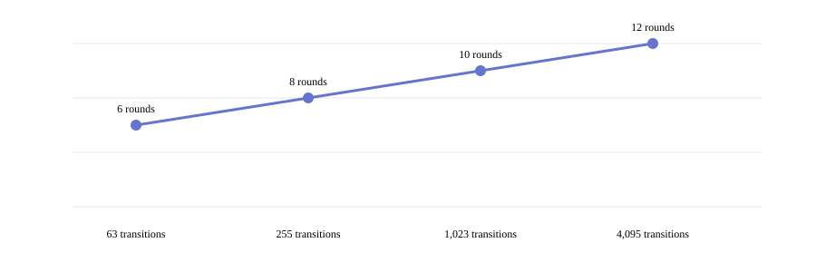

# Phase 16 — Gas benchmarks and protocol economics

**Result: PASS for the reproducible local benchmark scope.** The measurements below come from mined local Anvil receipts, not estimates. They are not Base Sepolia fee measurements and do not establish that BISECT is cheaper in general.

## Reproduction and measurement boundary

Run `pnpm phase16:benchmark` from the repository root. The command builds the TypeScript protocol packages and contracts, starts an isolated Anvil node on localhost, deploys a benchmark-only direct-execution harness and the actual `BisectDisputeRegistryV1`, sends transactions from Anvil test accounts, waits for receipts, checks contract accounting, and writes the JSON and chart artifacts under `docs/benchmarks/` and the read-only dashboard copy under `apps/web/public/benchmarks/`.

The direct baseline uses the same six-instruction deterministic loop program, exact eight-value public input and approved transition count as its optimistic counterpart. It calls the verifier's program validator and the same Solidity `BisectVerifier.step` implementation once for each transition, then emits the final output. The harness is under `contracts/src/benchmarks/`; it is not the claim/dispute protocol and is not intended for deployment.

The no-dispute lifecycle includes an actual bonded `submitClaim`, delayed `finalize`, and pull `withdraw`. A successful-dispute lifecycle uses a same-output claim with one altered middle trace state, an independently committed valid challenger trace, every prover/challenger child-hash reveal, both terminal proofs, the real one-step settlement, and an actual withdrawal. Claim submission and bond deposit share one transaction; challenge opening and challenger bond deposit share one transaction. These are reported once in lifecycle totals.

## Environment and sample

| Item                                  | Observed value                                                           |
| ------------------------------------- | ------------------------------------------------------------------------ |
| Network                               | Local Anvil only                                                         |
| Chain ID                              | 31337                                                                    |
| Sample time                           | 2026-11-01 06:25:19 UTC                                                  |
| Measured transaction blocks           | 3–4052                                                                   |
| Foundry / Anvil                       | 1.8.7, commit `985eeea031d79922cd654d4e94e6c3701e1c7d73`                 |
| Solidity compiler                     | 0.8.30, optimizer enabled, 200 runs                                      |
| Effective gas-price range in receipts | 1,000,000,007–1,807,444,416 wei/gas (about 1.000000007–1.807444416 gwei) |
| Bond per participant                  | 1,000,000,000,000,000 wei (0.001 test ETH)                               |
| Public testnet calls or deployments   | None                                                                     |

ETH paid for gas is the sum of each receipt's `gasUsed × effectiveGasPrice`; values below do not include bond principal. Anvil's dynamic fee values vary over the run. The raw artifact records each transaction hash, block, calldata byte count, gas used, effective price, receipt gas cost, and `msg.value`.

## Measured comparison

Each cell shows **gas units / ETH paid for gas**. The direct baseline is one transaction. The honest optimistic lifecycle is three transactions. The disputed lifecycle transaction count is `2 × rounds + 5`: claim, challenge, two moves per round, two terminal reveals, and withdrawal. Deployment gas is excluded from these lifecycle totals.

| Transitions |                Direct VM baseline |       Honest claim, no dispute | Successful invalid-claim dispute | Bisection rounds | Dispute transactions | Dispute calldata bytes |
| ----------: | --------------------------------: | -----------------------------: | -------------------------------: | ---------------: | -------------------: | ---------------------: |
|          63 |    148,259 / 0.000267969901671744 | 561,107 / 0.000870677930488701 | 2,198,883 / 0.002534297423467035 |                6 |                   17 |                  7,364 |
|         255 |    495,470 / 0.000803480055667070 | 530,588 / 0.000753034982518816 | 2,534,538 / 0.002565930149505983 |                8 |                   21 |                  8,340 |
|       1,023 |  2,058,521 / 0.003046718452455360 | 534,330 / 0.000710255687292774 | 2,869,923 / 0.002871644467866842 |               10 |                   25 |                  9,316 |
|       4,095 | 11,098,409 / 0.015273759096360310 | 533,210 / 0.000684062126231458 | 3,205,514 / 0.003205569412652357 |               12 |                   29 |                 10,292 |

At 63 and 255 transitions, the direct computation baseline used less gas than the full honest claim lifecycle. In this particular loop, the no-dispute optimistic lifecycle became lower-gas than direct execution between 255 and 1,023 transitions. A successful dispute cost more than direct execution at 63, 255, and 1,023 transitions. At 4,095 transitions, the measured dispute lifecycle used about 71% less gas than the direct-execution baseline. This is a workload-specific result, not a universal break-even guarantee.

## Transaction and proof details

| Operation                                                | Measured result                                                                                           |
| -------------------------------------------------------- | --------------------------------------------------------------------------------------------------------- |
| Claim submission with prover bond                        | 403,349–437,549 gas; exact bond value is in the same receipt                                              |
| Challenge opening with challenger bond                   | 293,293–293,317 gas; exact bond value is in the same receipt                                              |
| Both participants' child-hash moves, per bisection round | 159,728–208,161 gas for the pair of receipts; 2 on-chain transactions per round                           |
| Isolated v1 one-step verifier harness call               | 70,452–81,899 gas; authenticated invalid transition returned `false`                                      |
| Actual prover terminal adjudication                      | 214,071–230,430 gas; includes terminal proof checks, one-step verification, settlement writes, and events |
| Finalization                                             | 44,360–83,360 gas in the observed receipt states                                                          |
| Pull withdrawal                                          | 40,198 gas per withdrawal receipt                                                                         |
| One inclusion path's sibling bytes                       | 192, 256, 320, and 384 bytes at the four supported budgets                                                |
| Two terminal proof calldata sizes                        | 1,700, 1,828, 1,956, and 2,084 bytes per terminal transaction                                             |

The isolated one-step measurement uses the same internal verifier entrypoint and a real transaction to a benchmark-only wrapper. It is kept separate from dispute lifecycle totals. The actual terminal receipt is the relevant protocol transaction cost and includes proof authentication and settlement in addition to the transition check.

The full report artifact contains the gas and fee receipt for each individual midpoint move, not just the range above. It also contains the off-chain execution, Merkle construction, proof generation, and SDK replay timings. In this one local sample, these respective timings at 63/255/1,023/4,095 transitions were: VM transition loop 0.084/0.286/0.729/2.397 ms; Merkle construction 7.978/28.887/113.508/399.450 ms; one proof generation 8.287/28.651/111.750/404.520 ms; and full SDK replay 41.532/65.974/237.274/870.253 ms. These are single-run host timings and should be rerun on target hardware before making latency claims.

## Additional financial scenarios

| Scenario                                                                               | Actual transactions |  Gas used |         Receipt gas cost | Result                                                                                      |
| -------------------------------------------------------------------------------------- | ------------------: | --------: | -----------------------: | ------------------------------------------------------------------------------------------- |
| Dishonest challenger against an honest prover, followed by finalization and withdrawal |                  18 | 2,279,326 | 0.002279326015955282 ETH | Prover won; challenger bond was credited to prover; both credits were withdrawn once        |
| Prover misses the first required game move; permissionless timeout and withdrawal      |                   4 |   869,350 | 0.000869350006085450 ETH | Contract applied the specified prover-timeout outcome and credited both bonds to challenger |
| Two simultaneous claims, independently finalized, one combined withdrawal              |                   5 | 1,008,780 | 0.001008780007061460 ETH | Exactly 0.002 test ETH was observed locked for the two claims before finalization           |

Across the measured run, actual contract reads and receipt events reconciled as follows:

| Accounting measure                             | Observed amount |
| ---------------------------------------------- | --------------: |
| Bond deposits                                  |       0.018 ETH |
| Peak locked exposure                           |       0.006 ETH |
| Finalization and settlement credits            |       0.018 ETH |
| Confirmed withdrawals                          |       0.018 ETH |
| Collateral redistributed from the losing party |       0.006 ETH |
| Final locked funds / credits / liabilities     |   0 / 0 / 0 ETH |
| Final contract balance                         |           0 ETH |
| Protocol fees                                  |           0 ETH |

The 0.006 ETH called redistributed collateral was not burned or treated as gas. It became winner credit and was withdrawn. The contract remained solvent at every financial operation checked by the runner. The 139 measured workload transactions used 31,230,912 gas and paid 0.038071387014335522 ETH in receipt fees. The two harness/registry deployment receipts are kept separate: 5,678,480 gas and 0.010870482116321300 ETH.

## Artifacts and verification

- `packages/sdk/scripts/phase16-benchmark.mts` — reproducible actual-receipt runner.
- `contracts/src/benchmarks/DirectExecutionBenchmark.sol` and `contracts/test/DirectExecutionBenchmark.t.sol` — isolated direct baseline and verifier measurement wrapper, reusing the v1 verifier logic.
- `docs/benchmarks/phase-16-results.json` — complete machine-readable sample, including each receipt and financial reconciliation.
- `docs/benchmarks/phase-16-gas.svg` and `docs/benchmarks/phase-16-rounds.svg` — generated charts from that sample.
- `apps/web/public/benchmarks/` — the same generated, explicitly local sample used by the read-only dashboard.

Verification ran against the final source and regenerated sample:

| Command                        | Result                                                                                                                                                                                                    |
| ------------------------------ | --------------------------------------------------------------------------------------------------------------------------------------------------------------------------------------------------------- |
| `pnpm phase16:benchmark`       | Passed; regenerated the 139-receipt Anvil sample at 2026-11-01 06:25:19 UTC.                                                                                                                              |
| `pnpm contracts:build`         | Passed; Foundry compiled the benchmark harness and the existing contracts with Solidity 0.8.30. The bounded harness produces one Foundry lint warning for classifying a transition error inside the loop. |
| `pnpm contracts:test`          | Passed; 59 tests across 8 suites, including fuzz and 256-run accounting invariants.                                                                                                                       |
| `pnpm lint --reporter=summary` | Passed, exit 0; 16 warnings and 609 informational suggestions, no errors.                                                                                                                                 |
| `pnpm format:check`            | Passed; 191 files checked.                                                                                                                                                                                |
| `pnpm typecheck`               | Passed across all 7 applicable workspace projects.                                                                                                                                                        |
| `pnpm test`                    | Passed; 73 tests across 12 files.                                                                                                                                                                         |
| `pnpm build`                   | Passed; protocol packages and optimized Next.js production build completed.                                                                                                                               |
| `pnpm e2e`                     | Passed; 27 Chromium tests against the fresh production build.                                                                                                                                             |
| `pnpm web:a11y`                | Passed; 2 Chromium accessibility smoke tests.                                                                                                                                                             |

The first full browser attempt reused a Next.js process from an earlier build. A rerun against a fresh production process exposed and fixed two dashboard regressions (a duplicate `status` role and narrow-screen header overflow). The final 27-test browser run passed after those fixes.

The benchmark is not a Base Sepolia gas forecast. Base execution pricing, L1 data fees, sequencer conditions, confirmation delay, and public RPC behavior are not represented. It is a single run using one six-instruction loop, one bond size, one optimizer configuration, and a clean local chain. The benchmark does not include UI, indexer, database, archive publication, or off-chain challenger operating costs. The direct baseline performs VM computation but does not implement claim storage, challenge protection, or settlements, while the protocol lifecycle does; the table names that scope difference rather than treating it as equal service functionality. The contracts remain unaudited.
